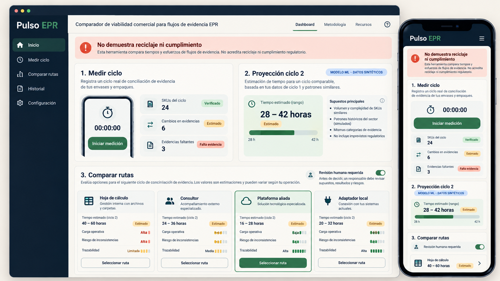
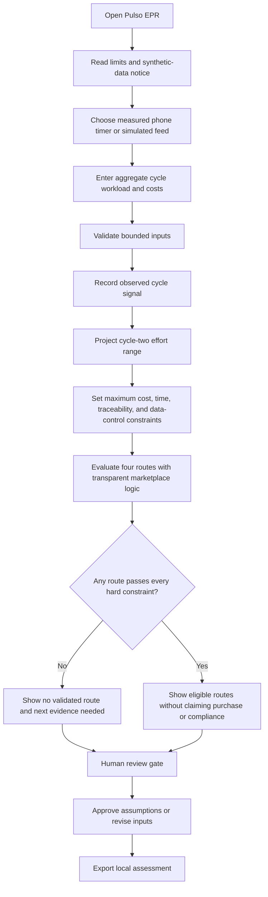
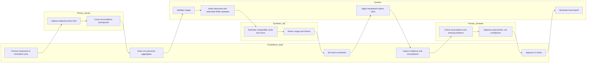

# Pulso EPR - Week 11 build packet

**Owner:** David Buzali  
**Course:** Business Bending, Week 11 - When Scarcity Ends - and What We Lose Anyway  
**Blueprint vacuum:** EPR-COMPLIANCE - Packaging Evidence Diagnostic  
**Declared role:** MONEY  
**Status:** packet before code

## The problem, in my words

Mexico's new circular-economy framework creates a plausible payer for packaging evidence work, but it does not prove that another software product deserves to exist. A producer or importer may already have a spreadsheet, consultant, specification platform, or global EPR system. The commercial unknown is narrower: can a repeat packaging-reconciliation cycle be completed with less total effort and better traceability, without hiding the labor, missing evidence, or dependence on human review?

Pulso EPR measures that question before prescribing a product. It captures a bounded reconciliation cycle, keeps measured and estimated values separate, projects a comparable second cycle with a plainly labeled synthetic-data model, and compares four routes under user-set constraints. It does not certify compliance, calculate legal obligations, prove recycling, or produce environmental claims.

## Exact user

Paula is an invented 37-year-old packaging-compliance coordinator at a mid-sized cosmetics importer in Guadalajara. She reconciles roughly 280 active SKUs each quarter using supplier files, sales exports, email, and a consultant. She can estimate internal hourly cost and consultant fees, but she cannot justify buying a platform from a polished demo alone. She needs a defensible way to compare the next cycle, show assumptions to her director, preserve missing evidence, and say "none of these routes is proven" when the data is weak.

No real company or person is represented. All starting data is synthetic and visibly labeled.

## Success definition

Before the module closes, Paula can open the live URL on a phone or desktop, measure or simulate one packaging-evidence cycle, enter aggregate non-personal workload and cost inputs, see a labeled cycle-two effort range, compare spreadsheet, consultant, partner-platform, and local-adapter routes against her own constraints, inspect why an option passed or failed, require human approval, and export a portable assessment.

Success is a transparent commercial test. It is not a sale, renewal, compliance decision, recovery claim, 10:1 return, or proof that proprietary software should be built.

## Image-generated mockup

This pre-code concept was generated with OpenAI image generation on October 24, 2026. It defines the information hierarchy, visible uncertainty, and review gate; it is not product evidence.

## Feature flow

## Actor swimlane

## Benchmark line

**Best existing solution on Earth:** Recyda is the strongest direct benchmark because it centralizes packaging data, identifies gaps, calculates EPR obligations across more than 20 countries, and exports audit-ready declarations from one platform ([Recyda product](https://www.recyda.com/product/epr-reporting-and-compliance-platform)).

**How mine differs or localizes:** Pulso EPR does not duplicate Recyda's compliance engine; it is a pre-procurement Mexican viability test that makes the current workflow, second-cycle hypothesis, localization gap, and total human effort comparable before a team decides to adapt, partner, or build.

Specright is the specification-data benchmark, with structured component records, supplier evidence, version history, and EPR outputs through Lorax ([Specright PPWR](https://www.specright.com/ppwr/)). Lorax ENVI is the reporting and outsourced-service benchmark, holding jurisdictional rules, timelines, fees, and auditable reports ([Lorax ENVI](https://www2.loraxcompliance.com/solutions/eprreportingsoftware)). Their existence raises the burden of proof for a local build.

Mexico's Ley General de Economía Circular was published on January 19, 2026. It defines REP across a product's life cycle for producers or importers, requires applicable reports or documents, and leaves important implementation detail to regulations and general agreements ([Cámara de Diputados, LGEC](https://www.diputados.gob.mx/LeyesBiblio/pdf/LGEC.pdf)). The prototype therefore treats regulatory readiness as uncertain and never claims legal compliance.

## Three-year long view

If this slice works, Pulso EPR becomes an independent procurement and operations evidence layer for Mexican producers deciding whether to improve spreadsheets, use consultants, partner with a global platform, or fund a narrow local adapter. Its longitudinal dataset shows real first- and second-cycle labor, exceptions, supplier burdens, and total costs without trapping customer data or converting estimates into compliance claims. The venture earns the right to build only when repeated paid use exposes the same local gap that existing platforms cannot close economically.

## Scope cut

This week does **not** build:

- a regulatory calculator, legal opinion, EPR declaration, fee engine, filing service, or compliance certificate;
- a packaging database, supplier portal, document repository, user account, CRM, procurement checkout, or paid marketplace;
- live Recyda, Specright, Lorax, ERP, PLM, email, or government integrations;
- a production-trained model or a claim that synthetic predictions are accurate for a real company;
- environmental-impact, recyclability, additionality, recovery, worker-benefit, or 10:1-return claims;
- worker identity collection, profiling, automated exclusion, or a substitute for paper evidence;
- a platform recommendation when no option meets every declared constraint.

## Blueprint conditions and shadow clause

| Blueprint condition | This slice's implementation |
|---|---|
| 1. Additional value | Four routes are compared; existing platforms are named as the benchmark. "Partner/adapt before build" is a hard decision rule. |
| 2. Credible payer and recurring value | The user measures one cycle and tests a second-cycle hypothesis. The app states that one payment and one prediction do not prove renewal. |
| 3. Evidence integrity | Every value is marked measured, user-provided, synthetic estimate, or missing. Model drivers and version are visible. |
| 4. Operational feasibility | Inputs expose SKUs, revisions, exceptions, evidence completeness, review time, and external fees. Human work is included. |
| 5. Human consequences | A burden panel names who performs extra work and blocks any claim that efficiency or worker benefit has been proven. |
| 6. Shadow clause | Unsupported recycling/compliance claims are blocked; missing and paper evidence remain reviewable; worker data is never requested; approval is explicitly human. |

## Architecture and stack

| Layer | Choice | Why |
|---|---|---|
| Interface | React 19 + TypeScript + Vite | Responsive, accessible static slice with fast iteration. |
| IoT / sensing | Phone timer, checkpoint counter, Page Visibility events, optional motion permission; labeled simulated fallback | Captures actual workflow signals without personal or packaging-document data. |
| ML | Deterministic linear inference over synthetic training coefficients, with displayed version, range, and drivers | Tests whether a forecast helps decision-making while avoiding false claims of learned production accuracy. |
| Marketplace logic | Constraint-first comparison across four operating routes | Tests adapt, partner, consult, or keep spreadsheet before proprietary development. |
| Data | Browser memory plus user-triggered JSON export | No server, account, analytics, or personal-data storage. |
| Security | Strict numeric bounds, enumerated options, no free text, no secrets, no database, no third-party requests | Minimizes attack surface and satisfies this slice's security floor. |
| Hosting | Vercel static deployment | Free, reproducible public delivery. |

## Test plan

### Mechanical pass

1. Unit-test numeric validation, sensor summaries, ML range stability, hard constraints, no-eligible-route behavior, and export minimization.
2. Run TypeScript and the production build.
3. Test measured and simulated flows at phone and desktop widths.
4. Confirm every prediction and simulated value remains visibly labeled.
5. Confirm no route can be called eligible when one hard constraint fails.
6. Find and document at least one defect, fix it, rerun tests, and redeploy.
7. Search the repository and production bundle for secrets, real personal data, unsupported compliance/recycling claims, and hidden tracking.

### Persona pass

Use a fresh synthetic persona: **Paula, 37**, an invented packaging-compliance coordinator in Guadalajara who works across spreadsheets, supplier PDFs, and a consultant; reads quickly but distrusts opaque ROI promises; and stops using tools that blur estimates with facts. Walk her through screenshots in sequence, log every hesitation, and fix the highest-severity confusion before the final deployment.

### Acceptance criteria

- Measured and simulated sensor modes are impossible to confuse.
- The app validates every input and stores no free-form or personal information.
- Cycle-two output is a range, names its synthetic model version, and exposes the strongest drivers.
- Each route shows total estimated cost, hours, traceability, data control, assumptions, and failed hard constraints.
- No route appears eligible unless it passes every user-set hard constraint.
- The interface can truthfully return "no route validated."
- Human approval is required before export, and is described as assumption review rather than compliance approval.
- The export contains only aggregate inputs, model metadata, option results, and review state.
- The live build works without secrets, a backend, or third-party calls.

## Kill criteria

Stop before a real pilot if a customer will not share comparable first- and second-cycle effort; if vendor pricing or Mexican coverage cannot be verified; if manual work is routinely omitted; if users read an estimate as legal approval; if the model cannot outperform a simple range based on the measured cycle; or if existing vendors solve the recurring job at an acceptable total cost. Do not build proprietary compliance software merely because the spreadsheet is painful.

